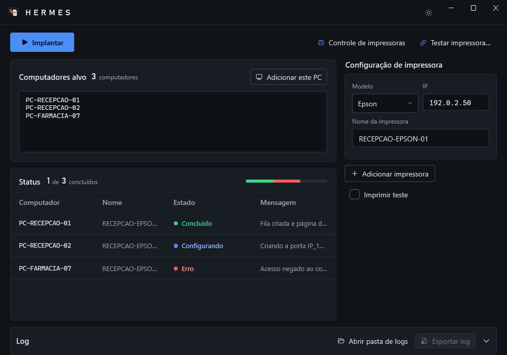

<h1 align="center">PrinterInstall</h1>

<p align="center">
  Windows desktop application that installs and standardizes network printers and thermal label printers on workstations.
</p>

<p align="center">
  <a href="README.md">Português</a> · <strong>English</strong>
</p>

<p align="center">
  
  &nbsp;
  
</p>

---

## About the project

PrinterInstall is a .NET 8 and WPF application that automates network printer setup in corporate and hospital environments. It creates TCP/IP ports, installs drivers and configures queues on many computers remotely, without setting up each machine by hand.

The solution has two layers: `PrinterInstall.Core` (driver catalog, LDAP authentication, orchestration and remote WMI/CIM operations) and `PrinterInstall.App` (MVVM interface built with WPF-UI). Every resource it creates is recorded in a rollback journal, and the orchestrator undoes completed steps if an installation fails or is cancelled.

---

## Features

| Feature | Description |
|---|---|
| Batch deployment | Installs queues on several computers at once, with live status. |
| Automatic rollback | Removes created ports and queues when installation fails on a workstation. |
| Control wizard | Lists, renames and removes queues on remote computers or the local machine. |
| Direct test | Prints test pages or labels straight to raw port 9100 before installing. |
| Gainscha labels | Configures the Patient (89 × 36 mm), Matrix (50 × 30 mm), Wristband (25 × 270 mm) and Batch (45 × 13 mm) sizes. |
| Domain authentication | Validates credentials against Active Directory via LDAP, in UPN or NetBIOS format. |
| Reports | Exports a log with the result of each operation. |

---

## Stack

- **.NET 8 and WPF with WPF-UI**: Windows application with a Fluent interface.
- **CommunityToolkit.Mvvm and Microsoft.Extensions.Hosting**: MVVM and dependency injection.
- **System.Management**: WMI/CIM calls for spooler ports, drivers and queues.
- **System.DirectoryServices.Protocols**: LDAP authentication against Active Directory.
- **Seagull SSDAL and SDS**: media calibration for Gainscha thermal printers.
- **xUnit and Moq**: automated tests.

---

## Getting started

### Prerequisites

- [.NET 8 SDK](https://dotnet.microsoft.com/download/dotnet/8.0).
- Windows 10, Windows 11 or Windows Server.
- Credentials with administrative rights on the target computers.

### Steps

1. Clone the repository and build the solution:

   ```powershell
   git clone https://github.com/brendonpereiradev/PrinterInstall.git
   cd PrinterInstall
   dotnet build PrinterInstall.sln
   ```

2. Start the application:

   ```powershell
   dotnet run --project src/PrinterInstall.App
   ```

3. On first run, set the domain and LDAP server from the settings icon and sign in as `user@domain` or `DOMAIN\user`.

### Available commands

| Command | Description |
|---|---|
| `dotnet build PrinterInstall.sln` | Builds the solution. |
| `dotnet run --project src/PrinterInstall.App` | Starts the application. |
| `dotnet test PrinterInstall.sln` | Runs the tests. |
| `pwsh scripts/Publish-PrinterInstall.ps1` | Builds the single-file executable in `publish/PrinterInstall`. |
| `python scripts/Test-PublicData.py` | Checks that the repository holds no real environment data. |
| `pwsh scripts/Test-Secrets.ps1` | Scans for secrets before pushing changes. |

---

## Documentation

- [User guide (PDF)](docs/Manual-PrinterInstall.pdf) (Portuguese): illustrated guide to using the application.
- [User manual](MANUAL.txt) (Portuguese): support procedures, screens and troubleshooting.
- [Tested models](MODELOS_TESTADOS.txt) (Portuguese): devices and drivers validated per manufacturer.

---

## License

Distributed under the MIT license. See [LICENSE](LICENSE).

Bundled third-party drivers and utilities belong to their manufacturers and follow their own license terms.
